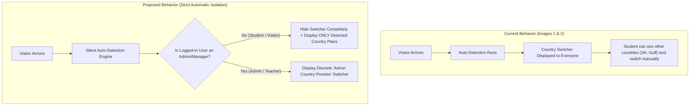
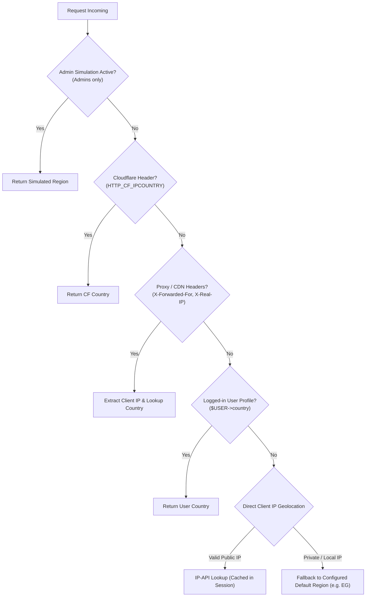

# Comprehensive Technical Plan: Automatic Country Detection & Strict Regional Price Isolation

## 1. Executive Summary & Objective

Based on the requirements and uploaded screenshots:
1. **100% Automatic Detection:** When a visitor lands on the course page, their country/region is detected automatically in the background without requiring any user action.
2. **Hide Manual Switcher for Students:** Remove or hide the `Country / Region: [Egypt (EG)] [Saudi Arabia & Gulf (GULF)]` pill buttons from regular students and public visitors so they cannot view or switch to other countries' pricing.
3. **Strict Price Isolation:**
   - A visitor from **Egypt** sees **ONLY** Egyptian pricing packages (e.g., EGP plans). Saudi Arabia (`SA`), Gulf, and International (`USA`/`Global`) options are completely hidden.
   - A visitor from **Saudi Arabia / Gulf** sees **ONLY** Gulf pricing packages (e.g., SAR plans).
   - A visitor from the **USA / Rest of the World** sees **ONLY** Global packages (e.g., USD plans).
4. **Admin Simulation Mode:** Site administrators and course managers must still have a way to preview what different countries see (without needing a VPN or spoofing IPs).

---

## 2. Screenshot & Current Flow Analysis



### Key Issues Identified:
1. **The Switcher is Currently Public:** `showcountryswitcher` currently defaults to showing the switcher pills to anyone when multiple regional instances exist in a course.
2. **Price Leakage & VPN Arbitrage:** If students see the switcher, they can compare prices across countries or select a cheaper tier regardless of their real location.
3. **Local Testing / Proxy Inaccuracies:** When testing on local machines or private IPs (`127.0.0.1`, private networks, Docker), IP-API lookups return empty, causing unexpected fallbacks unless an admin override is available.

---

## 3. Architectural Design

### 3.1. Strict Regional Filtering Logic
In `wallet/classes/plugin.php:render_pricing_table()`:
- Determine the visitor's effective region (`EG`, `GULF`, `GLOBAL`) via `geo::get_user_country()`.
- Filter the course's active enrolment instances:
  - If instances matching the visitor's detected region exist, **show exclusively those instances**.
  - All instances assigned to other regions (`GULF`, `GLOBAL`, `EG`) are completely removed from the `$displayinstances` array.
  - If no instance matches the detected region, fallback gracefully to `GLOBAL`.
- Calculate column layout (`col-md-6`, `col-md-4`, etc.) based **only** on the remaining filtered instances.

### 3.2. Switcher Visibility Control: Three-Tier Policy
Replace the simple boolean toggle with a configurable access policy:
- **Option 1: Disabled (Default)**: The country switcher is never displayed on enrolment pages. Zero clutter, 100% silent detection.
- **Option 2: Admins & Managers Only (Recommended)**: The switcher is only visible to users with `moodle/course:enrolconfig` or `moodle/site:config` capability (Admins, Managers, Editing Teachers). Students and unauthenticated visitors see nothing.
- **Option 3: Everyone**: Accessible to all users (legacy behavior).

### 3.3. Advanced Auto-Detection Engine (`classes/local/utils/geo.php`)
Enhance the detection priority chain to ensure reliability in production, staging, and local development:



#### Detailed Detection Tiers:
1. **Admin Simulation Override (`wallet_preview_region`):**
   - Active only if the current user has `has_capability('moodle/site:config', context_system::instance())` or `has_capability('enrol/wallet:config', ...)`.
   - Allows site managers to test Egypt, Gulf, or Global views directly with a single click or URL parameter `?wallet_preview_region=EG`.
2. **Cloudflare `CF-IPCountry`:**
   - If the site is routed through Cloudflare, reads `$_SERVER['HTTP_CF_IPCOUNTRY']` (instantaneous, 100% accurate, 0 network overhead).
3. **Reverse Proxy Headers (`X-Forwarded-For`, `X-Real-IP`):**
   - Extracts the original client IP when behind Nginx, Apache reverse proxy, or load balancers.
4. **Moodle User Profile Country (`$USER->country`):**
   - If the student is logged in and their profile has a 2-letter country code (e.g. `EG`, `SA`), uses it as a trusted signal.
5. **Session-Cached IP Geolocation:**
   - For non-Cloudflare public visitors, queries `http://ip-api.com/json/{ip}?fields=countryCode` with a 1.5s connection timeout and caches the result in `$SESSION->wallet_geo_detected` for the duration of the visit.
6. **Configurable Default Site Region:**
   - Instead of always defaulting to `GLOBAL` when testing locally on localhost (`127.0.0.1`), add an admin setting: **Default Fallback Region** (`enrol_wallet/defaultfallbackregion`, e.g. `EG`, `GULF`, or `GLOBAL`). On local dev/test servers, it will automatically default to `EG` (Egypt) as desired!

---

## 4. File-by-File Implementation Plan

### 1. `wallet/classes/local/utils/geo.php`
- Add `get_effective_user_region(context $context)`:
  - Checks if user is admin/manager and has selected an admin preview region.
  - Inspects proxy headers (`X-Forwarded-For`, `X-Real-IP`) to find the real public IP.
  - Respects the site's configured `defaultfallbackregion` when on local/private IPs.
- Add `can_view_switcher(context $context)`:
  - Evaluates site setting (`countryswitcher_access`) against current user's capabilities.

### 2. `wallet/classes/plugin.php`
- In `render_pricing_table()`:
  - Retrieve the visitor's effective region using `geo::get_effective_user_region($context)`.
  - Strictly filter `$instances` to include **only** those matching `$activeregion`.
  - Hide the country switcher completely if `!geo::can_view_switcher($context)`.
  - If user is an admin/manager and switcher is in "Admins Only" mode, pass an `is_admin_preview` flag so the template can style it as an administrative preview bar (e.g., "Preview as: [Egypt] [Gulf] [Global]").

### 3. `wallet/templates/pricing_table.mustache`
- Remove the public country switcher pills from the student's header view.
- Add a discrete admin preview toolbar when `is_admin_preview` is true:
  ```mustache
  {{#is_admin_preview}}
  <div class="alert alert-info py-1 px-3 d-inline-flex align-items-center gap-2 mb-3 rounded-pill small">
      <span>🛠️ <strong>Admin Simulation:</strong></span>
      <div class="btn-group btn-group-sm">
          {{#region_switcher}}
          <a href="{{switch_url}}" class="btn btn-sm {{#is_active}}btn-primary active fw-bold{{/is_active}}{{^is_active}}btn-outline-primary{{/is_active}}">
              {{label}}
          </a>
          {{/region_switcher}}
      </div>
  </div>
  {{/is_admin_preview}}
  ```
- For students/visitors, only the wallet balance badge (if enabled) and the pricing title/subtitle remain visible.

### 4. `wallet/classes/local/utils/settings.php` & `classes/local/config.php`
- Replace/Enhance `showcountryswitcher`:
  - `enrol_wallet/countryswitcher_access`:
    - `0` => Hidden for Everyone (Strict Auto-Detection).
    - `1` => Visible to Admins & Teachers only (Recommended).
    - `2` => Visible to All Users.
  - `enrol_wallet/defaultfallbackregion`:
    - Dropdown with options: `EG` (Egypt), `GULF` (Saudi Arabia & Gulf), `GLOBAL` (International USD).
    - Solves testing on local environments without VPN.

### 5. `wallet/lang/en/enrol_wallet.php` & `wallet/lang/ar/enrol_wallet.php`
- Add strings for:
  - `countryswitcher_access`, `countryswitcher_hidden`, `countryswitcher_admins`, `countryswitcher_all`.
  - `defaultfallbackregion`, `defaultfallbackregion_desc`.
  - `admin_simulation_label` ("Admin Simulation Mode").

---

## 5. User Decision Points & Alignment

Before proceeding to code implementation:
1. **Switcher Visibility Preference:**
   - Do you prefer the switcher to be **completely removed for everyone**, or kept as an **Admins-only preview tool** so you can easily toggle between Egypt and Gulf views while testing as admin?
2. **Default Region for Local / Unknown IPs:**
   - When testing on a local server (`localhost` / `127.0.0.1`) where public IP lookups cannot run, should the default fallback region be set to **Egypt (`EG`)**?
